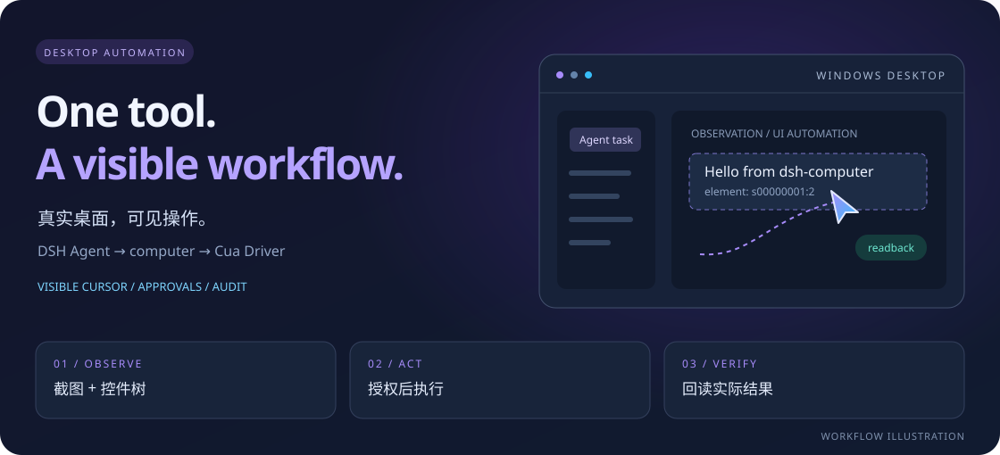

<p align="center"></p>
<h1 align="center">dsh-computer</h1>
<p align="center"><strong>让 AI 操作真实桌面，让每一步都看得见。</strong></p>
<p align="center">一个 computer 工具 · 可见 AI 光标 · 先观察，再行动，再验证</p>
<p align="center">
  <a href="https://github.com/Curlance/dsh-computer/actions/workflows/ci.yml"></a>
  <a href="https://github.com/Curlance/dsh-computer/releases"></a>
  
  
</p>
<p align="center">
  <a href="#亮点">亮点</a> · <a href="#快速开始">快速开始</a> · <a href="#工作方式">工作方式</a> · <a href="docs/GUIDE.md">完整指南</a> · <a href="https://github.com/Curlance/dsh-computer/releases">下载</a>
</p>

<picture>
  <source media="(max-width: 680px)" srcset="docs/images/overview-mobile.svg" />
  
</picture>
<p align="center"><sub>工作流程示意图；非实际运行截图。</sub></p>

dsh-computer 是面向 **DSH Desktop 的独立常驻插件**。它通过 Cua Driver 读取截图与 Windows UI Automation 控件树，让 Agent 在标准会话中按需操作桌面应用，无需切换预设或模式。

插件使用 ESM JavaScript，无需构建；运行时使用 DSH 提供的宿主接口，并通过本机 Cua Driver 执行桌面操作。

> **当前版本：0.1.0。** 已记录 Windows 真机截图、控件读取、点击、输入及回读验证。自动更新支持兼容性选择、SHA-256 校验与手动回滚，尚不能自动确认新版本加载成功。查看 [验证记录](docs/verification.md) 与 [版本变更](CHANGELOG.md)。

## 亮点

| | 能做什么 |
| --- | --- |
| **一个入口** | 用 `computer` 的 `observe / act / session` 完成观察、操作与会话管理，标准会话直接可用。 |
| **看见操作** | 独立 AI 光标展示点击、移动、拖拽与元素滚动的轨迹，让操作目标更直观。 |
| **先看再动** | 同时读取截图与控件树，优先按元素标识操作；过期观察需要重新获取。 |
| **回读结果** | 点击与输入后回读，区分 `confirmed`、`noop`、`unverifiable` 与 `refused`。无法验证不会被当作成功。 |
| **保留控制权** | 风险审批、密码框与 UAC 启发式阻断、用户输入检测，以及进程内单 Agent 租约。 |
| **便于维护** | 安装、自检、卸载与更新脚本齐备；JSONL 审计中的输入仅记录长度与哈希摘要。 |

## 快速开始

### 1. 准备环境

| 依赖 | 要求 |
| --- | --- |
| 系统 | Windows 10 / 11，当前支持主显示器 |
| Node.js | **24 或更高版本**；CI 使用 Node 24 |
| DSH Desktop | **`>=0.2.1-rc.2 <0.3.0`**，不满足范围会拒绝加载 |
| Cua Driver | **0.36 或更高版本**，提供 `cua-driver mcp`；[上游安装说明](https://github.com/trycua/cua/tree/main/libs/cua-driver) |

### 2. 安装插件

在 PowerShell 中运行：

```powershell
git clone https://github.com/Curlance/dsh-computer.git
cd dsh-computer

node scripts/install.mjs --dry-run
node scripts/install.mjs
node scripts/doctor.mjs
```

无需 `npm install` 或构建。安装器会写入版本目录、profile 链接、操作 skill 和托管配置，并备份已有的同名 skill。检测到旧版 `dsh-computer-use` 时会执行迁移；自定义路径、备份与恢复见 [完整指南](docs/GUIDE.md#安装)。

### 3. 重启并开始使用

**完全退出并重启 DSH**，新建一个标准会话，确认可以使用 `computer` 工具。可以先试试：

> 观察当前活动窗口，告诉我它是什么应用、有哪些可操作控件，先不要点击。

想验证输入时，先手动打开一个空白记事本，再告诉 Agent：

> 在当前记事本中输入“Hello from dsh-computer”，然后回读确认文字是否出现，先不要保存。

遇到环境问题，运行 `node scripts/doctor.mjs --json` 查看检查结果。驱动未被发现时，可设置 `CUA_DRIVER_BIN` 指向驱动可执行文件。

## 工作方式

**观察 → 安全检查 → 执行动作 → 回读验证**。Agent 根据最新观察选择目标，并使用工具返回的实际效果决定下一步。

下面是 `computer` 工具的调用参数示例，不是终端命令：

**① 观察活动窗口**，获取截图、控件标识和 revision。

```json
{ "action": "observe", "target": { "kind": "active" }, "mode": "both" }
```

**② 按控件输入**。将示例中的 `s00000001:2` 替换为本次观察返回的真实元素标识。

```json
{
  "action": "act",
  "op": "type",
  "target": { "element": "s00000001:2" },
  "text": "Hello from dsh-computer"
}
```

**③ 检查结果**。查看动作返回的 `effect`；需要继续操作时重新观察，也可以查询会话状态：

```json
{ "action": "session", "op": "status" }
```

<details>
<summary><strong>支持的动作与坐标规则</strong></summary>

`act.op` 支持 `click`、`doubleClick`、`rightClick`、`move`、`type`、`key`、`scroll`、`drag`、`wait`、`launch`、`focus`、`resize`、`kill`；可用 `steps[]` 顺序执行多个动作。

优先使用元素标识。坐标属于**最近一次观察的截图空间**，是窗口本地像素；观察默认 60 秒过期。批量操作也会逐步授权与记录。完整参数及错误处理见 [computer-use skill](skills/computer-use/SKILL.md)。

</details>

## 安全与边界

插件操作的是当前用户的**真实桌面**。默认高风险动作需要审批；密码框、UAC / 安全桌面和没有当前观察的盲动作会被阻断。用户近期有键鼠输入时，插件会暂缓动作。

- **启发式防护，非沙箱。** 密码框识别与用户空闲检测存在局限；检测失败时当前实现可能放行。截图会进入模型上下文。
- **应用策略按窗口标题匹配。** 白名单与黑名单使用标题子串；限流与租约仅在进程内生效。
- **当前仅支持 Windows 主显示器。** 驱动 0.36 的焦点元素等待存在限制；观察预算无法中断正在执行的 UIA 遍历。
- **更新后需要人工检查。** SHA-256 用于完整性校验，发布包未签名；尚无运行时健康心跳或加载失败自动回滚。

审批模式、控制权规则与完整限制见 [安全模型](docs/SAFETY.md)；配置项见 [配置指南](docs/GUIDE.md#配置)。

## 更新与维护

完全退出 DSH 后，在仓库根目录检查更新：

```powershell
node scripts/update.mjs --manifest "https://github.com/Curlance/dsh-computer/releases/latest/download/compat.json" --check
```

将 `--check` 改为 `--apply` 应用更新；需要恢复上一版本时运行 `node scripts/update.mjs --rollback`。计划任务与兼容性规则见 [自动更新指南](docs/AUTO-UPDATE.md)。

卸载前可用 `node scripts/uninstall.mjs --dry-run` 预览，再运行 `node scripts/uninstall.mjs`。审计与备份数据会保留，详见 [卸载与恢复](docs/GUIDE.md#卸载)。

## 开发与验证

```powershell
npm test
```

单元测试注入宿主、驱动和时钟，不需要启动 DSH 或操作桌面；CI 使用 Windows + Node 24。真机验证记录单独保存在 [docs/verification.md](docs/verification.md)。真机冒烟命令见 [开发指南](docs/GUIDE.md#开发与测试)。

## 文档导航

| 我想了解… | 从这里开始 |
| --- | --- |
| 安装、迁移、配置和卸载 | [完整指南](docs/GUIDE.md) |
| 工具参数与操作规范 | [computer-use skill](skills/computer-use/SKILL.md) |
| 审批、控制权与残余风险 | [安全模型](docs/SAFETY.md) |
| 发布、校验和回滚 | [自动更新](docs/AUTO-UPDATE.md) |
| 插件内部如何协作 | [架构与不变量](docs/ARCHITECTURE.md) |
| 已验证的行为与版本变化 | [验证记录](docs/verification.md) · [CHANGELOG](CHANGELOG.md) |

---

<p align="center">Built for DSH Desktop · Powered by <a href="https://github.com/trycua/cua">Cua Driver</a></p>
